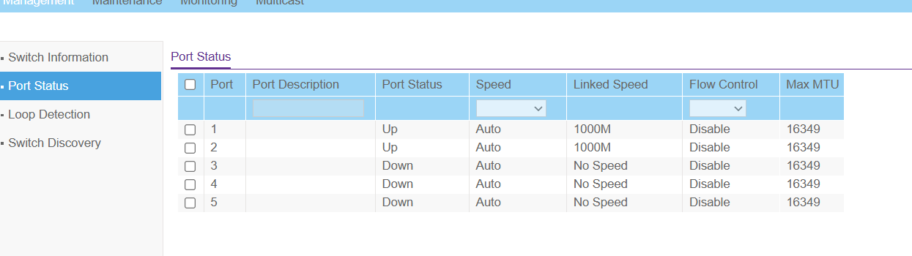
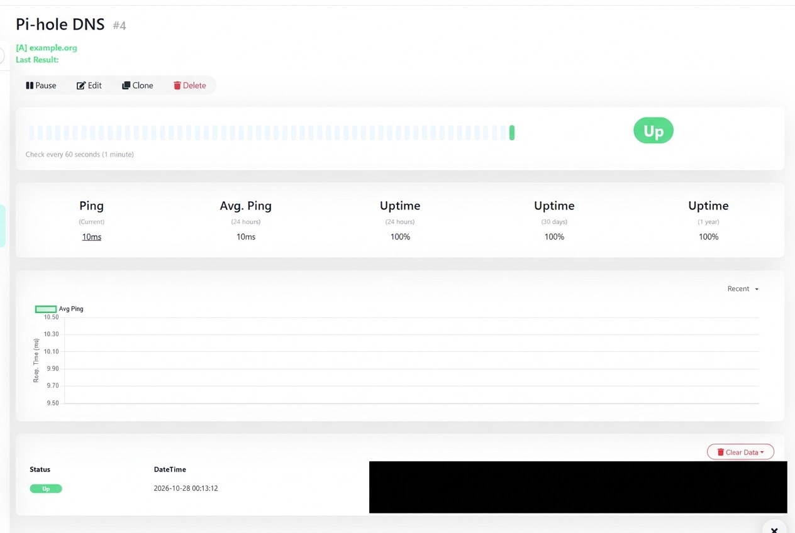
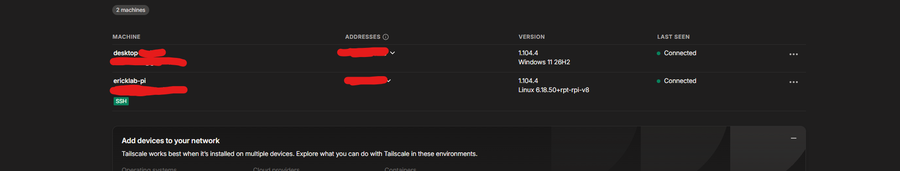

# Home Network Infrastructure Lab

I wanted a homelab that would be useful at home while helping me build real networking and Linux skills. I started with a Raspberry Pi 4 and a NETGEAR GS305E managed switch, then added monitoring, DNS filtering, and remote access.

## Hardware and network

The switch gives me enough Ethernet ports for the Pi and my other devices. I checked its port status to confirm the connected devices had active gigabit links. I also reserved addresses for the switch and Pi through my router so I can find them consistently without manually setting static addresses on either device.

I assembled the Pi, installed Raspberry Pi OS, and set up SSH key access so I can administer it from my laptop. I hit a boot issue along the way. After reimaging the SD card, I eventually realized the card was still in my laptop instead of the Pi—a good reminder to check the physical setup before assuming the software is broken.

## Services I set up

### Uptime Kuma

I run Uptime Kuma in a Docker container to keep it separate from the other services on the Pi and make it easier to manage. It checks things like router reachability and whether Pi-hole DNS is responding. I can see the results in one dashboard and configure notifications for failed checks.

One limitation: because Kuma runs on the Pi at home, it cannot send me an alert if the Pi is off or my home internet cannot reach the notification service. External monitoring would be a future improvement.

### Pi-hole and Unbound

Pi-hole filters DNS requests from my laptop using blocklists containing roughly 280,000 domains. If a requested domain is blocked, Pi-hole refuses to resolve it. This helps reduce some ads and unwanted connections, though it cannot catch every ad or malicious site.

For allowed domains, Pi-hole forwards the request to Unbound running on the Pi. Unbound performs the DNS lookup instead of forwarding every request to a public resolver. I tested this from my laptop and checked Pi-hole’s query log to confirm requests were being handled and a test domain was blocked. I kept this limited to my own laptop so it would not disrupt my family’s devices.

### Tailscale

I added Tailscale to my Pi and laptop so I can reach the Pi over a private connection when I am away from home, without opening a port on my router. I also configured my laptop to use Pi-hole DNS through Tailscale. This gives me a practical way to manage the lab remotely and use DNS filtering outside my home.

## What I learned

This project helped me practice switch management, DHCP reservations, Linux and SSH administration, Docker, DNS troubleshooting, and checking whether a service actually works from a client device. My next goal is to improve the monitoring and recovery process as I continue building the lab.

