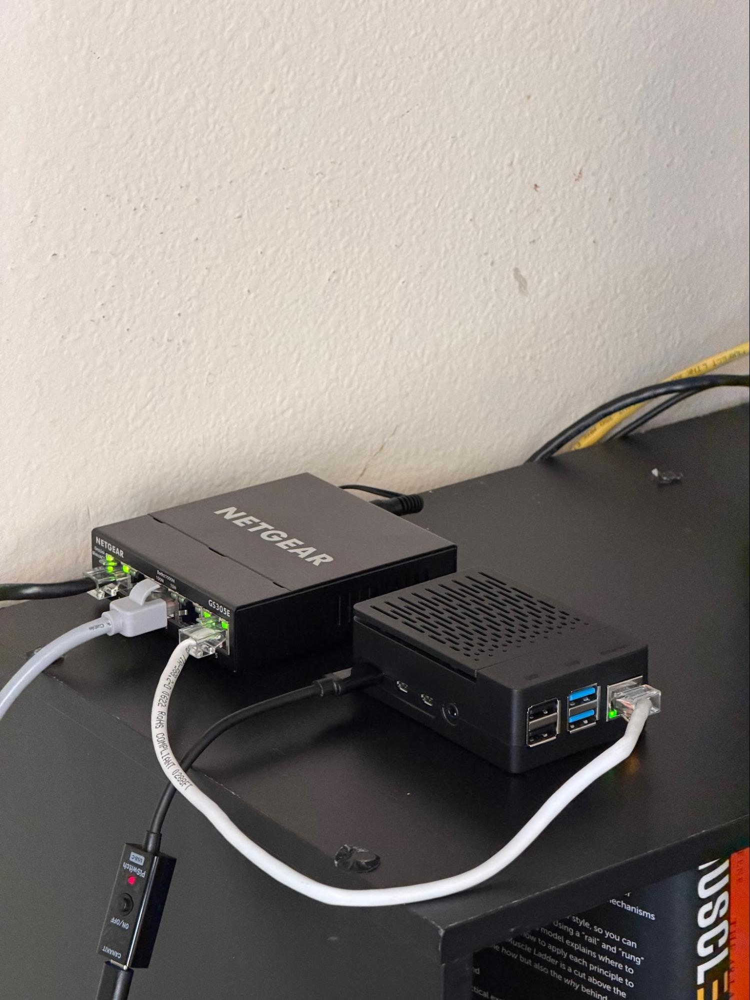
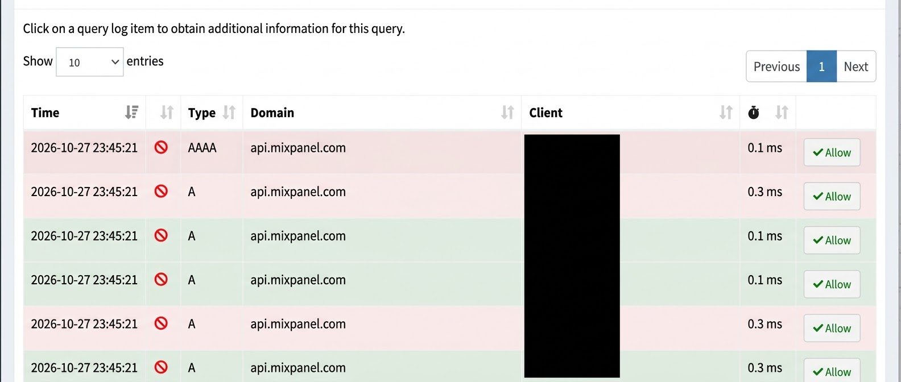

# HomeLab README

## 1. What I built

I wanted to build a home lab that wasn’t just impressive to recruiters or the public. I wanted something that brought real value to my own home environment. From researching Raspberry Pis and the crazy price of them to actually purchasing one and using it for my homelab, it has been a great journey.

I started off simple by deploying Uptime Kuma, a network monitoring system that checks whether parts of my setup are working. Say, for example, my home router stops responding: Kuma can alert me when that check fails, as long as the Pi and its internet connection are still working. If my home internet goes out completely, Kuma cannot send me an alert during the outage because it runs inside my home. I also ran it in a Docker container because that makes the service easier to install and manage without interfering with the rest of my Raspberry Pi.

I also set up Pi-hole, a DNS filtering service for my laptop, along with Unbound. Super useful: my blocklists contain nearly 280,000 domains. If my laptop requests a domain on those lists, Pi-hole blocks the DNS lookup. That can stop some ads and unwanted connections, though it cannot block every ad or unsafe link.

Lastly, I wanted to reach my Raspberry Pi when I’m not home and get the benefits of DNS filtering while I’m away. I configured Tailscale to connect my laptop and Pi through a private network over the internet, without opening a port on my home router.

These services brought real benefits to my setup and gave me the hands-on experience I was looking for to expand my technical skills outside of school, competitions, clubs, and my jobs.

## 2. Hardware and network

I didn’t feel it was worth mentioning before, but I purchased a managed switch for this environment because my router doesn’t have enough Ethernet ports. I chose a NETGEAR GS305E that I plan to experiment with more later. For this lab, I verified that the connected ports were up and negotiated gigabit links. I also used my router’s management app to set up DHCP reservations so my Pi and switch retain predictable addresses.

I assembled the Raspberry Pi and installed Raspberry Pi OS on its SD card. I ran into trouble getting it to boot and reimaged the card while troubleshooting. Eventually, I realized I had left the reimaged card in my laptop instead of putting it back in the Pi. Once it was in the Pi, I was able to boot and use the SSH key access I had configured to connect from my laptop. That was a good reminder to check the physical setup before assuming the software is the problem.

## 3. Services used

### Uptime Kuma

Uptime Kuma has been beyond useful. When I first deployed it, my reason was to monitor my network, and that WAS true. Now I recognize its value beyond checking my router. I can also monitor homelab services such as Pi-hole DNS and see whether they are responding. These are only the first services I wanted to set up on my Pi, and I plan to use Kuma to check more of them as the lab grows.

### Pi-hole + Unbound

Uptime Kuma is useful for my homelab projects, sure, but Pi-hole and Unbound have brought the greatest day-to-day benefit to me. Pi-hole has blocked requests to ad-related domains that I don’t need in my life.

Unbound is a DNS resolver that lets my Raspberry Pi look up domains without forwarding every request to a public resolver such as Google or Cloudflare. Here’s how I understand the flow: my laptop asks Pi-hole for a website’s IP address. Pi-hole checks whether the domain is blocked. If it’s allowed, Pi-hole asks Unbound, which performs the lookup and returns the answer. Boom, my laptop can use that address to reach the website.

I tested this on my own laptop first so I wouldn’t change DNS for the rest of my family. I confirmed that my laptop could resolve an allowed domain and that a blocked domain appeared in Pi-hole’s Query Log.

### Tailscale

I deployed Tailscale on my Raspberry Pi because I want to be able to access it at school, if I’m being completely honest with you. Perhaps one day someone will ask to see my Pi through the Linux command line, and boom, I’ll be ready.

My laptop and Pi are both signed in to my Tailscale network. That gives my laptop a private route to the Pi for SSH access without exposing SSH through my home router. I also configured my laptop to use Pi-hole DNS through Tailscale when I’m away. I still want to test the entire setup from a network outside my home so I can document that result properly.

## Thank you for reading! :)
